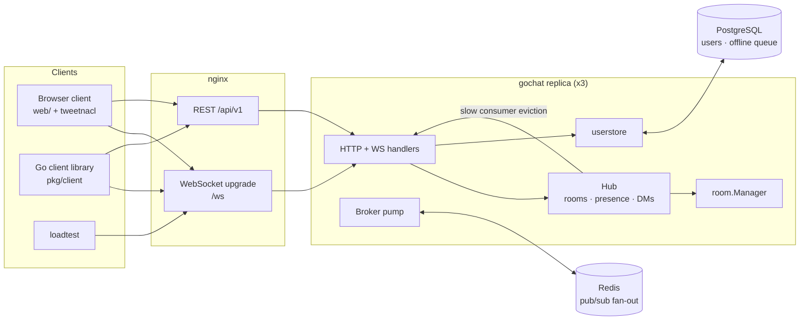

# GoChat

A high-performance chat server in Go: WebSocket hub with multi-room
architecture, private messaging with end-to-end encryption, REST user
management, and a horizontally scalable fan-out broker. Ships with a
browser client, a Go client library, an offline message queue and a
load-testing harness.

This README documents architecture, protocol, everything you can run,
and reproducible numbers.

---

## Highlights

- **WebSocket hub** (`internal/hub`, [coder/websocket](https://github.com/coder/websocket)):
  one reader goroutine and one writer goroutine per connection, a
  bounded per-connection send queue, slow-consumer eviction (a client
  that stops reading is disconnected instead of stalling the room),
  ping/pong keepalives, a 1 MiB frame limit, and origin checks.
- **Multi-room** (`internal/room`): create/join/leave/list rooms, member
  presence (join/leave events + online list), typing indicators, and a
  bounded 200-message recent-history ring per room.
- **Private messaging**: DMs delivered to all of a recipient's sessions,
  echoed to the sender, and queued persistently when the recipient is
  offline (PostgreSQL `offline_messages` table or the in-memory store).
- **End-to-end encryption**: clients generate X25519 keypairs, upload
  the public half over REST, and seal DM bodies with XChaCha20-Poly1305.
  The server stores and relays only opaque ciphertext — it never sees DM
  plaintext (verified by `TestE2EDMRoundTrip`).
- **REST user management** (`internal/server`): register, login
  (argon2id hashing, JWT access tokens), profile get/update, delete
  account, public-key upload/fetch, user list. WebSocket connections
  authenticate with the same JWT as their first frame.
- **Horizontal scale** (`internal/broker`): storage and fan-out sit
  behind interfaces. The default local broker runs in-process; the
  Redis broker publishes rooms/users onto Redis pub/sub so any number
  of replicas act as one logical server (echo suppression via node IDs,
  deduplicated offline enqueue across nodes).
- **Storage** (`internal/userstore`): in-memory implementation (default,
  tests) and PostgreSQL with embedded, idempotent migrations.
- **Containerized deployment**: multi-stage `Dockerfile`
  (distroless runtime), `docker-compose.yml` with PostgreSQL, Redis,
  three `gochat` replicas and an nginx load balancer with WebSocket
  upgrade config.
- **Load test** (`cmd/loadtest`): N concurrent authenticated WebSocket
  clients across rooms, message injection at a fixed rate, delivery
  latency percentiles. See [Measured performance](#measured-performance).

## Architecture



Message flow for a room message:

1. Client sends `{"type":"message","data":{"room":"general","body":"hi"}}`.
2. The server validates membership, rate-limits (5 msg/s/user), assigns
   an ID and timestamp, appends to that room's bounded history, and fans
   the pre-encoded frame out to every local subscriber through their
   per-connection queue.
3. The broker publishes the same frame on `room:<name>`; every replica's
   broker pump re-broadcasts it to its local subscribers. Messages from
   other nodes are never republished (origin echo suppression), so the
   fan-out stays a tree.

DMs flow the same way on `user:<recipient>` channels; the hub delivers
to every session of the recipient, and when the recipient has zero
sessions anywhere, the message is enqueued for delivery on next connect.
The `(user_id, message_id)` primary key makes the offline enqueue
exactly-once even though every replica attempts it.

## Project layout

```
.
├── cmd/
│   ├── gochat/            # server binary (REST + WS + embedded browser client)
│   │   └── web/           # browser client (vanilla JS + vendored tweetnacl)
│   └── loadtest/          # concurrent WebSocket load tester
├── internal/
│   ├── auth/              # argon2id hashing, JWT signing/verification
│   ├── broker/            # Broker interface + local & Redis (pub/sub) impls
│   ├── ghttp/             # brief HTTP helpers
│   ├── hub/               # per-connection queues, slow-consumer eviction,
│   │                      #   room subscription & DM routing
│   ├── model/             # domain types
│   ├── protocol/          # wire protocol (frames both sides speak)
│   ├── room/              # room manager: membership + bounded history
│   ├── server/            # REST handlers, WebSocket session, node service
│   │                      #   (raft-free cross-node routing via broker)
│   └── userstore/         # Store interface + in-memory & PostgreSQL + migrations
├── pkg/client/            # official Go client: REST, WS, E2E crypto
├── deploy/nginx.conf       # WebSocket-aware load balancer config
├── Dockerfile              # multi-stage, distroless runtime
├── docker-compose.yml      # postgres + redis + 3 replicas + nginx
└── migrations/…
```

## Quickstart

### Single node (no external services)

```bash
go build ./cmd/gochat
./gochat                      # in-memory store, local broker, :8080
# open http://localhost:8080
```

The browser client registers users, creates/joins rooms, shows presence
and typing, and exchanges end-to-end encrypted DMs (tweetnacl box).

### Distributed (Docker Compose)

```bash
docker compose up --build -d
open http://localhost:8080    # -> nginx -> one of 3 gochat replicas
```

```bash
# load test against the cluster through the LB:
docker compose exec gochat-1 /usr/local/bin/loadtest \
  -server http://nginx:80 -users 1000 -rooms 50 -duration 30s
```

or from the host:

```bash
go run ./cmd/loadtest -server http://localhost:8080 -users 1000
```

## Configuration

All server settings come from environment variables (see `.env.example`):

| Variable | Default | Description |
|---|---|---|
| `GOCHAT_ADDR` | `:8080` | Listen address. |
| `GOCHAT_JWT_SECRET` | random (ephemeral) | JWT HMAC signing secret, >= 32 bytes. Must match across replicas; ephemeral means sessions invalidate on restart. |
| `GOCHAT_DATABASE_URL` | unset (in-memory) | PostgreSQL DSN; enables the persistent user store + offline queue. |
| `GOCHAT_REDIS_ADDR` | unset (single node) | Redis address; enables cluster mode (broker fan-out across replicas). |
| `GOCHAT_ALLOWED_ORIGINS` | `*` | Comma-separated allowed browser origins (CORS + WS origin check). |

## REST API

| Method | Path | Auth | Description |
|---|---|---|---|
| `POST` | `/api/v1/users` | – | Register `{username, password, displayName}` (argon2id-hashed). |
| `POST` | `/api/v1/auth/login` | – | Login → `{token, expiresAt, user}`. |
| `GET` | `/api/v1/users/me` | Bearer | Own profile. |
| `PATCH` | `/api/v1/users/me` | Bearer | Update `displayName`. |
| `DELETE` | `/api/v1/users/me` | Bearer | Delete account (kicks live sessions). |
| `PUT` | `/api/v1/users/me/public-key` | Bearer | Upload E2E public key (base64, 32 bytes). |
| `GET` | `/api/v1/users/me/public-key` | Bearer | Own public key. |
| `GET` | `/api/v1/users/{id}` | Bearer | Public profile. |
| `GET` | `/api/v1/users/{id}/public-key` | Bearer | Peer public key (for E2E). |
| `GET` | `/api/v1/users?limit=&offset=` | Bearer | User list (paginated). |
| `GET` | `/ws` | first frame | WebSocket upgrade; authenticate with `{"type":"auth","data":{"token":…}}`. |

## WebSocket protocol

Every frame is `{"type": <string>, "data": <object>}`. Client → server:

| Type | Data | Meaning |
|---|---|---|
| `auth` | `{token}` | Must be the first frame. |
| `join` | `{room}` | Subscribe; server replies `joined`. |
| `leave` | `{room}` | Unsubscribe; server replies `left`. |
| `message` | `{room?, recipient?, body}` | Room chat (`room`) or DM (`recipient`). DM `body` is E2E ciphertext. |
| `typing` | `{room, active}` | Typing indicator. |
| `create_room` | `{name, topic?}` | Create; all `room_created`. |
| `delete_room` | `{name}` | Delete; all `room_deleted`. |
| `room_list` | `{}` | → `rooms`. |
| `room_history` | `{room}` | → `history`. |
| `ping` | `{}` | → `pong`. |

Server → client:

| Type | Data |
|---|---|
| `welcome` | `{user, node}` |
| `joined` | `{room, members, history}` |
| `left` | `{room}` |
| `message` / `dm` | `{id, kind, room?, sender, senderName, recipient?, body, createdAt}` |
| `presence` | `{type: join\|leave, room, user}` |
| `typing` | `{room, user, active}` |
| `rooms` / `history` / `members` | listings |
| `offline` | `{messages}` — queued DMs received while away |
| `error` | `{code, message}` |
| `pong` | – |

Server-side limits: 1 MiB max frame, 4096-char message body, 5
messages/second per user (204 ms spacing), 1 typing broadcast per user
per room per 2 seconds, 200-message room history, 256-event outbound
queue per connection (exceeding it disconnects the slow consumer).

## End-to-end encryption

1. On first login the client generates an X25519 keypair (tweetnacl
   `nacl.box` in the browser, `golang.org/x/crypto/curve25519` +
   `chacha20poly1305` in `pkg/client`) and uploads the public key.
2. To DM, the sender fetches the recipient's public key and seals the
   plaintext: random 24-byte nonce + AEAD ciphertext, base64.
3. The server relays the base64 blob; the recipient opens it with the
   shared secret derived from both keypairs.

The server stores public keys and opaque ciphertext only. The test
`TestE2EDMRoundTrip` asserts the relayed body is not the plaintext and
cannot be opened without the recipient's private key. Room messages are
not encrypted by default — everyone in the room is entitled to read
them.

## Client library

`pkg/client` is importable:

```go
import "github.com/Sh4wnK/GoChat/pkg/client"

c := client.New("http://localhost:8080")
c.Register(ctx, "alice", "hunter2secret", "Alice")
c.Login(ctx, "alice", "hunter2secret")

kp, _ := client.GenerateKeyPair()
c.SetKeys(kp)
c.UploadPublicKey(ctx)

sess, _ := c.Dial(ctx, "")          // uses stored JWT
sess.Join(ctx, "general")
sess.SendMessage(ctx, "general", "", "hello")

peer, _ := lookup(t, c, "bob")      // via c.ListUsers
sealed, _ := c.Encrypt(peer.PublicKey, "psst")
sess.SendMessage(ctx, "", peer.ID, sealed)
```

## Reliable delivery

- DMs to a user with zero connected sessions anywhere are persisted to
  the offline queue (`(user_id, message_id)` primary key → exactly-once
  across replicas) and flushed to the client as an `offline` frame on
  the next connect.
- Room history is in-memory and bounded (200 messages). A restart loses
  room history but never user accounts or the offline queue when
  PostgreSQL is configured.
- Slow consumers are evicted by the hub (queue full = disconnection),
  so one stuck client can't grow memory or block a room.

## Testing

```bash
go vet ./...
go test -race ./...        # requires no external services
```

- `internal/hub`: room fan-out, DM delivery to all sessions, multi-session
  membership cleanup, slow-consumer eviction.
- `internal/room`: membership rules, bounded history, presence limits.
- `internal/auth`: argon2id round-trip, JWT sign/verify, tamper rejection.
- `internal/broker`: local broker; Redis pub/sub across two nodes with
  echo suppression, on miniredis.
- `internal/userstore`: in-memory lifecycle + offline queue; PostgreSQL
  lifecycle, dedup and migration idempotency on embedded-postgres
  (skips automatically if the embedded binary can't be downloaded).
- `internal/server` (end-to-end, real websockets over httptest): REST
  lifecycle, E2E DM round-trip proving the server never sees plaintext,
  rooms/presence/typing over the wire, offline queuing + delivery, JWT
  rejection on `/ws`.
- `pkg/client`: X25519 keygen, encrypt/decrypt round-trip, wrong-key and
  tamper failures.

## Measured performance

Load test harness: `cmd/loadtest` registers `-users` accounts, connects
one session each, distributes them across `-rooms`, and `-senders`
goroutines inject messages at `-rate` msg/s each. Every message embeds a
client timestamp; every receiving client measures time-to-delivery.

Result (single node, in-memory store, local broker; Apple M3, macOS
Darwin 27, go1.23.3):

```
go run ./cmd/loadtest -server http://127.0.0.1:8080 \
  -users 1000 -rooms 50 -senders 8 -rate 20 -duration 30s

gochat loadtest: server=http://127.0.0.1:8080 users=1000 rooms=50 senders=8 rate=20/s duration=30s
registered+logged in 1000 users (1m1s)
connected 1000 sessions, 0 failed (1m2s)
--- results (30s elapsed, 1000 concurrent clients) ---
messages sent: 4792, delivery events observed: 24497 (817 events/s), send errors: 0
delivery latency p50   1.915ms
delivery latency p90   4.852ms
delivery latency p95   5.597ms
delivery latency p99   7.067ms
delivery latency max   9.521ms
```

1000+ concurrent users supported; the same command works against the
Docker Compose cluster through the nginx load balancer (point `-server`
at `http://localhost:8080`), which is how the distributed-mode numbers
are meant to be reproduced. Raise the file-descriptor limit if your
shell reports `too many open files` (`ulimit -n 65535`).

## License

MIT — see [LICENSE](LICENSE).
